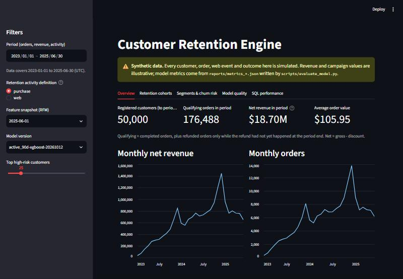
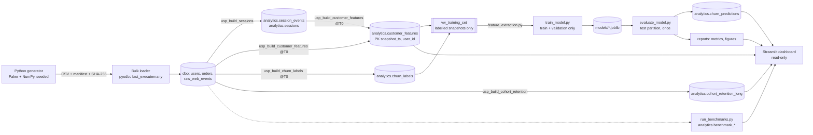
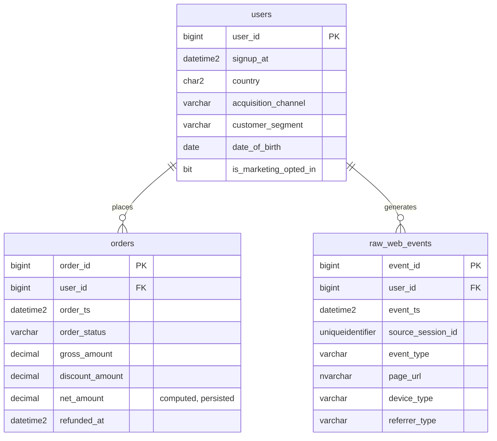
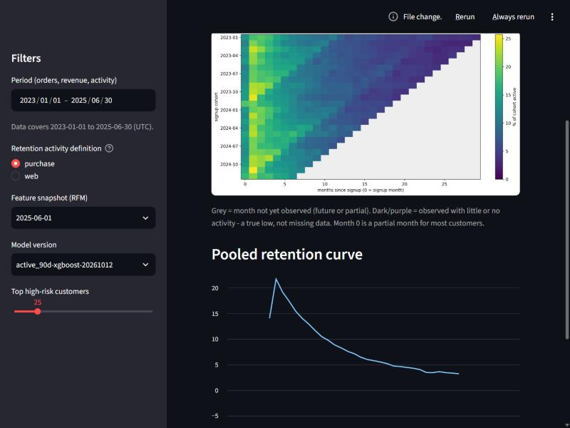
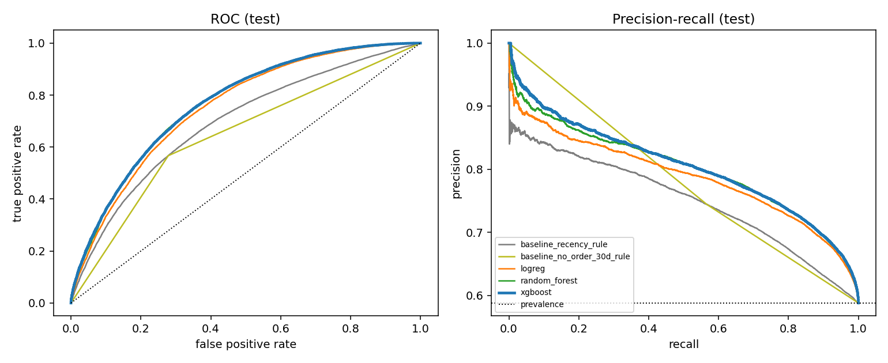
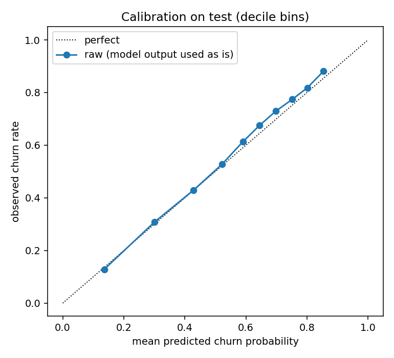
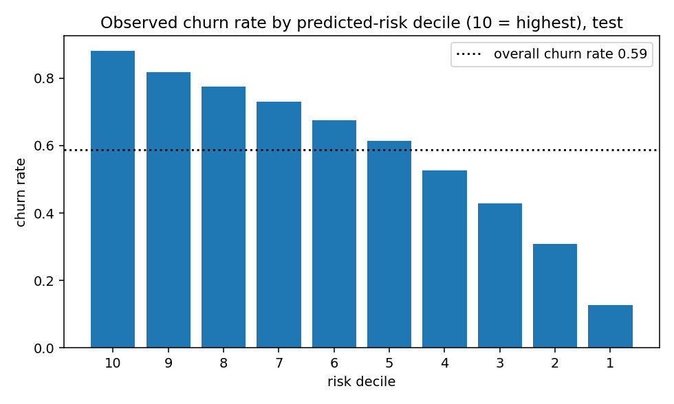
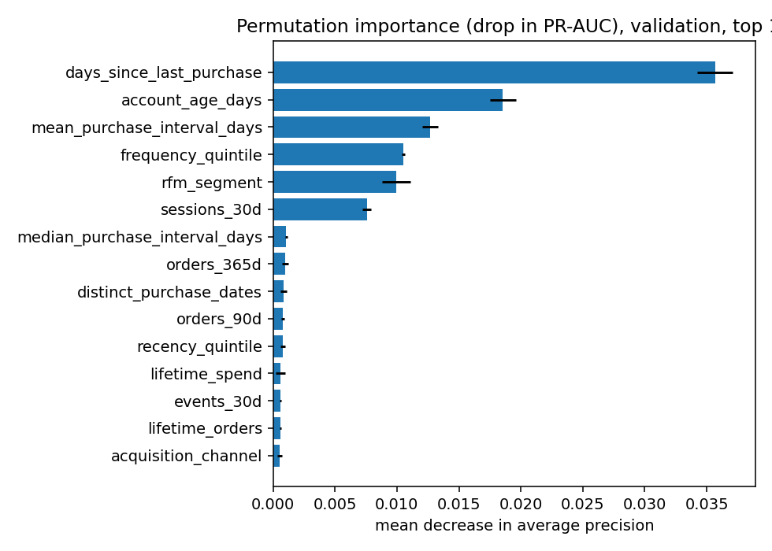
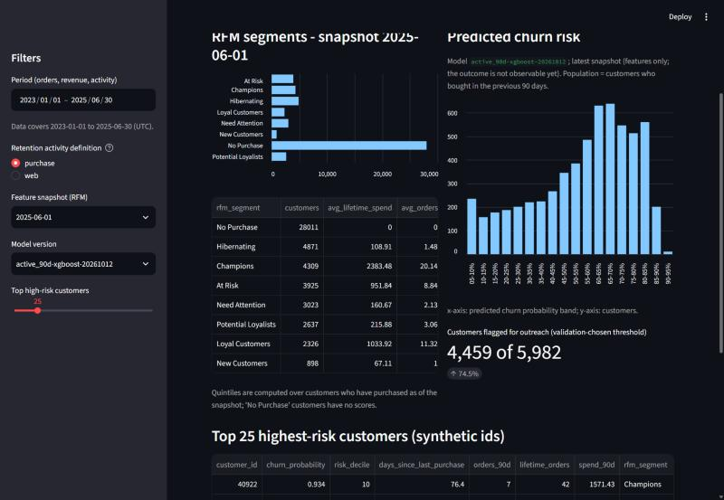
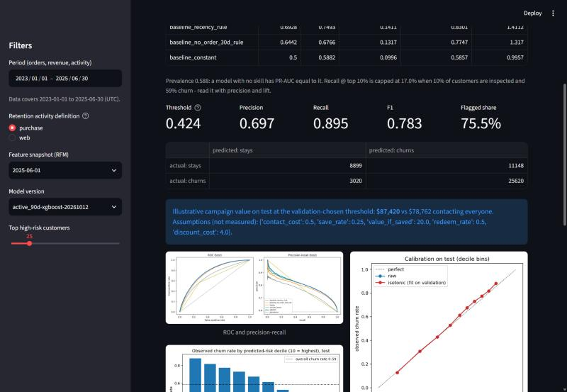

# Point-in-Time Customer Feature Store & Retention Engine

> A SQL Server feature store that computes **leakage-free, point-in-time customer features** for any historical
> cutoff, builds retention cohorts and 30-day inactivity labels, trains and honestly evaluates churn models on
> chronological holdouts, and benchmarks the SQL — with 162 automated tests and a Streamlit dashboard.
> **All data is synthetic.**



## Contents
1. [Overview](#1-overview) · 2. [Business problem](#2-business-problem) · 3. [Technical objectives](#3-technical-objectives) ·
4. [Architecture](#4-architecture) · 5. [Technology stack](#5-technology-stack) · 6. [Database schema](#6-database-schema-and-relationships) ·
7. [Synthetic data](#7-synthetic-data-generation) · 8. [SQL feature engineering](#8-sql-feature-engineering) · 9. [Sessionization](#9-sessionization-logic) ·
10. [Point-in-time contract](#10-point-in-time-feature-contract) · 11. [Churn label](#11-churn-label-definition) · 12. [Leakage prevention](#12-leakage-prevention) ·
13. [Cohorts](#13-retention-cohort-methodology) · 14. [Indexing & optimization](#14-indexing-and-query-optimization) · 15. [Python integration](#15-python-integration) ·
16. [ML methodology](#16-machine-learning-methodology) · 17. [Results](#17-evaluation-results) · 18. [Dashboard](#18-dashboard) ·
19-23. [Setup and commands](#19-installation) · 24. [Testing](#24-testing) · 25. [Limitations](#25-known-limitations) · 26. [Future work](#26-future-improvements) ·
[Verified vs untested](#verified-vs-untested) · [Portfolio text](#portfolio-text)

---

## 1. Overview
The project answers one question end to end: **"which customers who are buying today will have stopped by next month — and how do we
know the answer was not contaminated by the future?"**

* **Feature store in T-SQL** — one parameterised procedure builds ~40 features per customer (43 columns including keys and lineage) for *any*
  cutoff `@T0`, stored in a persistent table keyed by `(snapshot_ts, user_id)`. 28 monthly snapshots are built (2023-04 → 2025-07), 27 of them labelled.
* **Reconstructed web sessions** (30-minute inactivity rule) from ~1M raw events, with a deterministic tie-break.
* **Cohort retention** as a long-format table and a triangular matrix that never confuses "no activity" with "not observed yet".
* **Leakage-free labels** (30-day inactivity) generated only for complete outcome windows.
* **ML** — logistic regression, random forest, XGBoost vs. simple baselines, with a purged chronological train/validation/test split.
* **Performance engineering** — 18 benchmarks × 5 physical designs, actual-plan analysis, write-cost measurements and two negative results reported honestly.
* **Quality** — 162 pytest tests, including hand-built edge cases, an independent pandas oracle, and mutation checks that prove the tests can fail.

## 2. Business problem
Retention teams want to contact customers *before* they lapse, but only a limited budget is available and every offer has a cost.
The system ranks customers by lapse risk, quantifies the trade-off, and shows which segments, cohorts and behaviours drive it.
"Churn" here is an **operational inactivity definition** (no qualifying purchase in the next 30 days), not proof of permanent loss.

## 3. Technical objectives
Reproducible synthetic data → T-SQL transformations that are provably point-in-time correct → chronological ML evaluation → measured
query optimisation → automated tests and a reviewable dashboard, using only Microsoft SQL Server, Python and local tooling.

## 4. Architecture

```
 Faker/NumPy generator --CSV--> bulk loader --> dbo.users / dbo.orders / dbo.raw_web_events
                                                   |                |
                               usp_build_sessions  v                |
                         analytics.session_events / .sessions       |
                                       |                            |
              usp_build_customer_features(@T0)  <-------------------+--> usp_build_churn_labels(@T0)
                                       v                                         v
                         analytics.customer_features           analytics.churn_labels
                                       \________  vw_training_set  ________/
                                                       |
                       train_model.py (train+validation only) --> models/*.joblib
                                                       |
                       evaluate_model.py (test, once) --> analytics.churn_predictions + reports/
                                                       |
                       Streamlit dashboard (read-only) <-- cohorts, segments, benchmarks
```

## 5. Technology stack
Microsoft SQL Server (developed on 2025 Express; 2022+ features used: `GENERATE_SERIES`, batch mode) · T-SQL · Python 3.10+ (tested on 3.10.11) ·
SQLAlchemy 2 + pyodbc + ODBC Driver 18 · pandas · NumPy · Faker · scikit-learn · XGBoost · matplotlib · Streamlit · pytest · PowerShell.
Not used: PostgreSQL syntax, SQLite, distributed systems. Docker Compose is provided as an **untested** optional SQL Server.

## 6. Database schema and relationships
`dbo` = raw source data (never modified by the pipeline). `analytics` = everything derived, rebuildable from `dbo`. All timestamps are **UTC**, `DATETIME2(3)`.


Physical design (measured, see §14): `PRIMARY KEY NONCLUSTERED (id)` + `UNIQUE CLUSTERED (user_id, ts, id)` on orders and events, so one customer's history is contiguous and ordered.
`CHECK` constraints guard enums, non-negative money, `discount ≤ gross`, and refund consistency; foreign keys enforce referential integrity.
Cross-table rules (e.g. *no order before signup*) cannot be CHECK constraints and are enforced by `sql/13_validation_queries.sql` + tests after each load.

**Refund policy** (one rule, one function — `analytics.fn_qualifying_orders`): an order qualifies at time *t* if it is `completed`, or `refunded` **and the refund had not happened yet** (`refunded_at ≥ t`).
`cancelled` never qualifies. Refunds are full-order reversals, so nothing is counted twice or negatively. `refunded_at` was added to the minimum column list because judging refunds by
*current* status would leak the future (at one snapshot, 81 customers' order counts would have differed).

**`source_session_id` ≠ reconstructed session id.** The source id comes from the tracking client (cookies, tabs, app backgrounding): in the generated data ~25% of consecutive visits reuse it and some
ids span idle gaps of 31–120 minutes. Analytics therefore ignores it and rebuilds sessions from timestamp gaps.

## 7. Synthetic data generation
`src/data_generation.py` (vectorised NumPy; Faker for the seeded product/category catalogue). Default 50,000 users / **200,507 orders / 998,629 events**, seed 42 (volumes are targets, not exact).
Customers have a heavy-tailed order rate by segment, a "never buys" share, a lifetime (30% loyal), seasonality (Nov–Dec peak), growth, cancellations (~7%) and refunds (~5%) landing days later.
~60% of orders have a tracked purchase session; every user has a signup visit; ~4% of sessions contain an idle gap while keeping the same source id.
Reproducibility: the same seed gives byte-identical CSVs and an identical SHA-256 fingerprint (tested across processes). Loading is one transaction using `fast_executemany`, with constraints **enabled**;
re-loading non-empty tables is refused unless `--truncate` is passed. Every load is recorded in `analytics.data_load_log`.

## 8. SQL feature engineering
`sql/07_customer_features.sql` — one pass per source, then one row per user (orders and events are **never joined to each other**, so nothing multiplies):

| Group | Features |
|---|---|
| Recency | `days_since_last_purchase` (NULL if none), `has_purchased`, `last_purchase_ts` |
| Frequency | orders in 30/90/365 days, lifetime, previous-30-day orders, change |
| Monetary | spend 30/90/365/lifetime, average, max, sample stdev of order value |
| Purchase rhythm | mean / sample-stdev / **median** (`PERCENTILE_CONT`) interval, distinct purchase dates |
| Web | sessions, events (7/30/90 d), product views, cart additions, checkout starts, `conversion_rate_30d` |
| Segmentation | recency/frequency/spend `NTILE(5)` over buyers only, RFM segment (documented rules in the file header) |
| Quality | `snapshot_ts`, `feature_generated_at`, `has_web_events`, `account_age_days` |

*Missing ≠ zero:* counts and sums are `0` when nothing happened; averages, stdevs, intervals and quintiles stay `NULL` when undefined.
`conversion_rate_30d` = sessions with ≥1 purchase event ÷ sessions with ≥1 event in the 30-day window (NULL if no sessions).
Known quirk: `NTILE` splits tied values arbitrarily; ties are broken by `user_id`, which makes many 1-order customers span several frequency quintiles.

## 9. Sessionization logic
`sql/06_sessionization.sql`: `LAG()` → `CASE` (new session when the gap is **strictly greater than 30 minutes**, measured in milliseconds) → cumulative `SUM() OVER (PARTITION BY user_id ORDER BY event_ts, event_id ROWS UNBOUNDED PRECEDING)`.
A gap of **exactly** 30:00.000 stays in the same session; 30:00.001 starts a new one (both tested). `event_id` breaks timestamp ties, so numbering is identical on every run.
`reconstructed_session_id = user_id × 1,000,000 + session_seq`. `session_end_ts` is the last event (the timeout is not added); `device_type` is the first event's device.

## 10. Point-in-time feature contract
* A snapshot is a cutoff `@T0`. Features use information with timestamp **`< @T0`** — the cutoff itself is **excluded**. Windows are half-open: `[T0 − N days, T0)`.
* Population: users with `signup_at < @T0`.
* Order qualification is evaluated **as of `@T0`** (a refund after `@T0` had not happened yet).
* Web features are computed from events before `@T0`; a session straddling the cutoff contributes only its pre-cutoff events (tested, including the conversion rate).
* Adding any post-cutoff data and rebuilding the snapshot leaves it unchanged (tested).

## 11. Churn label definition
`churn_label = 1` ⇔ **no qualifying purchase in `[T0, T0 + 30 days)`**; the window start is inclusive and the end exclusive (purchases at exactly `T0` count; at exactly `T0 + 30d` do not).
Qualification is evaluated at the **end of the window**: an order refunded before the window closes does not count as retention. Labels are produced **only for complete windows**
(`T0 + 30d ≤ observation_end`); otherwise the procedure raises an error and writes nothing. The 2025-07-01 snapshot therefore has features but no labels (it is the scoring snapshot).
Users registered after `T0` are excluded. Users with no prior purchase *are* labelled and flagged `has_prior_purchase = 0`; the ML population is narrower (§16).

## 12. Leakage prevention
| Risk | Control |
|---|---|
| Features see the future | `< @T0` ranges; refund status judged at `@T0`; tests add future data and assert nothing changes; independent pandas oracle matches SQL for every user |
| Label window not fully observed | procedure refuses; leap-year edge case tested (2024-02-01 + 30d > observation end) |
| Train labels reach into validation/test | `validate_temporal_split` requires ≥ 30 days between partitions; it runs before training and before evaluation |
| Test set influences decisions | `train_model.py` never loads test (static test guards this); thresholds and calibration are decided on validation only |
| Label-like columns as inputs | explicit allow-list of features; `assert_no_leakage` at import time; outcome columns exist only in the view |
| Random split of overlapping snapshots | not used — chronological partitions only |

## 13. Retention cohort methodology
Cohort = signup month. Primary activity = ≥1 qualifying purchase in the calendar month (secondary: product-view-or-deeper web event). Month 0 = signup month (a partial month for most users).
A cell is *observed* only if its calendar month **ends on or before the observation end**; the partial last month is never reported.
`active_customers`/`retention_pct` are `NULL` for unobserved cells and a real `0` for observed months with no activity — the dashboard heatmap draws NULL grey and 0 dark.
The cohort denominator is every user who signed up that month, including those who never bought. Orders are read once into distinct `(user, month)` pairs.



## 14. Indexing and query optimization
Full details, plans and caveats: **[reports/performance_report.md](reports/performance_report.md)** (generated from the database by `scripts/benchmark_report.py`).
Method: 18 benchmarks × 5 designs; cold (buffer pool dropped) and warm runs; exact logical reads/CPU from session counters; actual execution plans summarised (scans, seeks, lookups, sorts, spills, memory grants,
estimate error, missing-index hints); result hashes compared across every design. Hardware: i5-1235U laptop, 16 GB, SSD, **SQL Server 2025 Express**.

| Workload (median warm) | Before | After |
|---|---|---|
| Heaviest customer's order history | 2,364 reads, 31 ms | **7 reads**, 1.7 ms (clustered by user/time) |
| One user's events for a year | 14,468 reads, 238 ms | **10 reads**, 2.0 ms |
| 1-day order window, all users | 2,369 reads, 31 ms | **8 reads**, 1.1 ms (covering time index) |
| `YEAR()/MONTH()` vs range predicate (with index) | 122 ms, 1,451 reads | **9 ms, 118 reads** |
| Sessionization core (window functions, 1M rows) | 8.2 s | **1.1 s** (batch mode, identical results) |
| Feature snapshot, late cutoff, end to end | 12.6 s (baseline layout) | **4.0 s** (deployed layout) |
| Feature snapshot, early cutoff, end to end | 5.7 s | **1.1 s** |

Honest negatives: clustering by user/time **did not** speed up sessionization (the cost is the row-mode window spool, not the sort); the single-pass cohort procedure is **not** faster than a correlated sub-select
(SQL Server already collapses it to one pass); an index on every table's timestamp roughly doubles bulk-insert time (≈7× on `session_events`), so only `IX_orders_ts` was adopted. SQL Server correctly **scans** instead of using an index
when a query reads ~45% of the table and the index does not cover it (demonstrated, B06b). Missing-index suggestions were treated as hypotheses and tested, not applied blindly.
Not evaluated: table partitioning, filtered indexes, concurrency, other editions. Elapsed times on small queries carry up to ~3× laptop noise; logical reads are exact.

## 15. Python integration
`src/database.py` — SQLAlchemy 2 engine over pyodbc / ODBC Driver 18: pooling (`pre_ping`, recycle), `fast_executemany`, login/query timeouts, parameterised queries only, credentials from the environment, Windows or SQL authentication.
Encryption is **on by default**. A fresh local instance uses a self-signed certificate, so local development sets `SQL_SERVER_TRUST_CERTIFICATE=yes` — an explicit, documented local exception; never use it against a remote server.
`src/feature_extraction.py` pulls finished feature rows (explicit column list, `chunksize` streaming; for data beyond RAM extract one snapshot at a time to Parquet/CSV or use `bcp`). Heavy relational work stays in SQL Server.

## 16. Machine learning methodology
* **Population:** customers who bought in the previous 90 days (`in_training_population`). Customers silent for 90+ days lapse ~97% of the time, which makes the task trivially easy and inflates metrics.
* **Partitions** (feature cutoffs): train 2023-04 → 2024-06 (15 snapshots, 62,823 rows) · validation 2024-08 → 2024-11 (4, 29,274) · **test 2025-01 → 2025-06 (6, 48,687; touched once)**. July and December 2024 are purge gaps.
* **Pipeline:** `Pipeline[derive → ColumnTransformer → model]` — median imputation with missing-indicators, scaling for logistic regression, one-hot with unseen-category handling, derived `overdue_ratio` (days since purchase ÷ own mean interval; NaN when undefined).
* **Models:** logistic regression (baseline), random forest, XGBoost (early stopping on validation). Small grids; **selection by validation PR-AUC**. If XGBoost cannot be installed, `HistGradientBoostingClassifier` is used (code path present, **not exercised** here).
* **Baselines:** constant score; recency rule (days since last purchase); "no order in 30 days" rule.
* **Class balance:** churn rate 56–59% — mild, so no resampling; PR-AUC is judged against prevalence.
* **Threshold:** maximises *illustrative* campaign value on validation (`src/config.py::BUSINESS`: contact cost, save rate, value saved, redemption rate, discount cost); closed-form break-even probability is checked in tests.
* **Calibration:** an isotonic calibrator is attached only if it improves Brier score on later validation snapshots by ≥1% — it did not, so raw probabilities are used.
* **Importance:** permutation importance on validation (drop in PR-AUC). **Experiment tracking:** `models/<tag>/metadata.json` (seed, versions, partitions, all runs, data fingerprint) + `reports/experiments.jsonl`.

## 17. Evaluation results
Test partition, 48,687 customer-snapshots, churn rate 58.8% (all values from `reports/metrics_active_90d.json`):

| Model | ROC-AUC | PR-AUC | Precision @ top 10% | Lift @ top 10% |
|---|---|---|---|---|
| Constant score | 0.500 | 0.588 | 0.586 | 1.00 |
| "No order in 30 days" rule | 0.644 | 0.677 | 0.775 | 1.32 |
| Recency rule | 0.693 | 0.749 | 0.830 | 1.41 |
| Logistic regression | 0.753 | 0.787 | 0.857 | 1.46 |
| Random forest | 0.765 | 0.800 | 0.877 | 1.49 |
| **XGBoost (champion)** | **0.766** | **0.804** | **0.881** | **1.50** |

* Top-risk decile churns 88%; bottom decile 13% (monotone). Recall @ top 10% = 0.150 — capped near 0.17 when 59% of customers churn, so read it with precision and lift.
* Stable across the six test months (ROC-AUC 0.761–0.775); customers **never seen in training** score 0.755 ROC-AUC.
* At the validation-chosen threshold (0.424): precision 0.697, recall 0.895, F1 0.783, flags 75% of customers. Illustrative campaign value ≈ \$87k vs \$79k for contacting everyone — **assumptions, not measured business results**.
* Probabilities are well calibrated (ECE 0.017, Brier 0.190). Top drivers: days since last purchase, account age, purchase interval, frequency quintile, RFM segment, sessions in 30 days.
* **Secondary experiment (all past buyers, no 90-day filter):** ROC-AUC looks better (0.912) but the recency rule alone reaches 0.889, so the model adds only +0.023 there vs +0.073 in the 90-day population — which is why the filter is the primary experiment.
* **Caveat:** the labels come from a stochastic generator, so the achievable ceiling is limited; the learned models beat the one-line recency rule by a modest margin and this should not be read as production-level performance.

| | |
|---|---|
|  |  |
|  |  |

## 18. Dashboard
`streamlit run dashboard/app.py` — KPIs with a date filter, monthly activity, cohort heatmap and pooled curve, RFM distribution, predicted-risk distribution, top-N highest-risk customers (synthetic ids only),
model metrics read from the evaluation files, and SQL benchmark comparisons. A banner labels everything synthetic. SQL access is **read-only**: every statement must pass a SELECT-only guard in Python, and `sql/15_dashboard_readonly_role.sql`
defines a database role that cannot write, cannot execute build procedures and cannot read `date_of_birth` or raw clickstream (verified with `EXECUTE AS`). The app binds to the address you give Streamlit — use `--server.address localhost`.

| | |
|---|---|
|  |  |

## 19. Installation
Requirements: Windows with PowerShell · SQL Server 2022+ (Express is enough; the full dataset occupies ~0.8 GB, under Express's 10 GB limit) · [ODBC Driver 18 for SQL Server](https://learn.microsoft.com/sql/connect/odbc/download-odbc-driver-for-sql-server) · Python 3.10+ (3.11+ recommended; only 3.10.11 was tested) · optionally SSMS.
```powershell
python -m venv .venv          # if your project folder is under a redirected AppData path, create the venv elsewhere (e.g. %USERPROFILE%\venvs\pitfs)
.\.venv\Scripts\Activate.ps1
pip install -r requirements.txt
```

## 20. Environment configuration
```powershell
Copy-Item .env.example .env       # .env is git-ignored; never commit it
```
Edit `.env`. **Windows authentication** (default): leave `SQL_SERVER_USERNAME/PASSWORD` empty. **SQL authentication**: set both. Named instance: `SQL_SERVER_HOST=localhost\SQLEXPRESS`, empty port; default instance/Docker: `localhost` + `1433`.
`SQL_SERVER_ENCRYPT=yes` stays on. A local self-signed certificate needs `SQL_SERVER_TRUST_CERTIFICATE=yes` (**local development only**; the scripts print a warning). Volumes: `NUM_USERS`, `NUM_ORDERS`, `NUM_EVENTS`, `RANDOM_SEED`, `BATCH_SIZE`.

## 21. Database setup
```powershell
.\scripts\run_sql.ps1 -Server "localhost\SQLEXPRESS" -TrustServerCertificate          # 01-04: database, schemas, tables, constraints (idempotent, never drops)
.\scripts\run_sql.ps1 -Server "localhost\SQLEXPRESS" -TrustServerCertificate -Files 05_*.sql,06_*.sql,07_*.sql,08_*.sql,09_*.sql,10_*.sql,11_*.sql
# optional dashboard role:  ... -Files 15_*.sql        explicit dev reset (drops the database!):  ... -Reset
```
Verify in SSMS: connect (Encrypt = Mandatory, trust certificate for a local instance) → *Databases ▸ CustomerFeatureStore ▸ Tables* shows `dbo.users`, `dbo.orders`, `dbo.raw_web_events` and the `analytics.*` tables;
expand *Constraints / Keys / Indexes* (e.g. `CK_orders_refund_consistency`, `CIX_orders_user_ts`). Run `sql/13_validation_queries.sql` and `sql/13b_validation_derived.sql` — every row must show `0`.

## 22. Data generation commands
```powershell
python scripts\generate_data.py                       # 50k / 200k / 1M from .env  (--users 2000 --orders 8000 --events 40000 for a quick dev set)
python scripts\load_data.py                           # refuses non-empty tables;  --truncate replaces the rows (database kept)
```

## 23. Pipeline execution commands
```powershell
python scripts\build_features.py                      # sessions + 28 monthly snapshots + labels + cohorts + 20 integrity checks (a few minutes)
python scripts\train_model.py                         # train + validation only        (~1 min)
python scripts\evaluate_model.py                      # test partition, figures, predictions -> SQL  (~30 s)
python scripts\run_pipeline.py                        # = features -> train -> evaluate;   --all --truncate also regenerates + reloads data
python scripts\run_benchmarks.py                      # REBUILDS INDEXES + drops the buffer pool: dev instance only (~25 min)
python scripts\benchmark_report.py                    # regenerates reports/performance_report.md from the stored results
streamlit run dashboard\app.py --server.address localhost
```

## 24. Testing
```powershell
python -m pytest            # 162 tests, ~75 s; database tests skip automatically if SQL Server or the loaded data is unavailable
```
Hand-built edge cases run in a **throwaway database** (`CustomerFeatureStore_Test`) built from the real `sql/` scripts, so the deployed code is what is tested. Coverage of the 20 required checks:
identifiers/integrity/money/status/timestamps/pre-signup activity (`test_data_quality`), session boundaries and the 30-minute gap (`test_sessionization`), no future orders/events and RFM/aggregate correctness and users without purchases (`test_point_in_time`),
cohort denominators and zero-vs-unobserved (`test_cohorts`), label windows and incomplete windows (`test_churn_labels`), determinism for a fixed seed (`test_data_quality`, `test_ml_pipeline`), plus the pandas oracle (`test_feature_pipeline`),
ML guards (`test_ml_pipeline`), dashboard (`test_dashboard_*`) and the benchmark harness (`test_benchmarking`).
**Mutation check:** 8 injected SQL bugs (e.g. `<` → `<=` at the cutoff, `>` → `>=` for the session gap, labels for incomplete windows) were all caught by the intended tests.

## 25. Known limitations
* Synthetic data and an assumed behavioural model: results say nothing about real customers; business values are illustrative.
* Modest model lift over a simple recency rule (+0.07 ROC-AUC); the label noise of the generator limits the ceiling.
* Benchmarks come from one laptop and **SQL Server Express** (≈1.4 GB buffer pool, batch-mode DOP 1); small-query elapsed times are noisy. Partitioning and filtered indexes were not evaluated. Concurrency was not tested.
* Batch mode is obtained by joining an empty columnstore table (a known workaround); a real columnstore index is the supported alternative, at a storage/write cost. Batch-mode plans request larger memory grants.
* `NTILE` tie handling is arbitrary-but-deterministic; refunds are modelled as full-order reversals only; `session_end_ts` excludes the inactivity timeout.
* Every snapshot is rebuilt in full (no incremental refresh); a full session rebuild takes ~35 s mostly in index maintenance.
* SQL scripts hard-code the database name `CustomerFeatureStore` (the tests substitute it). The dashboard has no user authentication. The repository is not yet under version control.

## 26. Future improvements
Incremental snapshot refresh · survival/hazard models and longer horizons · uplift modelling for the *treatment effect* of an offer (the current value model assumes a save rate) · real columnstore or partitioning on a larger dataset · Query Store regression alerts ·
SQL Agent scheduling on non-Express editions · model monitoring (drift, calibration over time) · authentication and row-level security for the dashboard · CI running the throwaway-database tests · Parquet export for very large extractions.

---

## Verified vs untested
| Verified by executing it (this repo, Windows, SQL Server 2025 Express, Python 3.10.11) | Written but **not** executed / not covered |
|---|---|
| All SQL scripts 01–15, idempotent re-runs; full data load; 162 pytest tests; all pipeline scripts; dashboard rendering (headless + browser); benchmark runs | `docker-compose.yml`; SQL authentication path in `run_sql.ps1` and the Python layer; restricted-login dashboard connection (`DASHBOARD_SQL_*`); Python 3.11+; SQL Server editions other than Express; the `HistGradientBoosting` fallback; `git` workflow (git is not installed on the dev machine) |

## Repository layout
```
sql/        01-04 database, schemas, tables, constraints · 05 load audit · 06 sessionization · 07 features · 08 cohorts · 09 labels · 10 orchestration/view/predictions
            11 workload indexes · 12 benchmark definitions · 13/13b validation queries · 15 dashboard role · 99 explicit dev reset
scripts/    run_sql.ps1 · generate_data · load_data · build_features · train_model · evaluate_model · run_pipeline · run_benchmarks · benchmark_report · benchmark_write_overhead
src/        config · database · data_generation · loading · validation · feature_extraction · modeling · evaluation · benchmarking
dashboard/  app.py (UI) · data.py (read-only data access)        tests/  10 files, 162 tests        docs/images/  figures + dashboard screenshots
models/ reports/ data/   generated artefacts (git-ignored)
```

## Portfolio text
**GitHub description:** *SQL Server point-in-time customer feature store with leakage-free churn labels, cohort retention, benchmarked T-SQL and a tested ML pipeline (synthetic data).*

**Resume bullet templates** — replace brackets with your own verified numbers; the figures in this repo were measured on the hardware above and are not guarantees elsewhere:
* Built a T-SQL point-in-time feature store (sessionization, RFM, cohort retention, 30-day labels) over **~1M events / 200k orders** with an independent pandas oracle and **162 automated tests**, including mutation checks that catch injected leakage bugs.
* Benchmarked **18 queries across 5 physical designs** using actual execution plans and exact logical reads; cut a customer's order-history lookup from **2,364 to 7 reads** and the sessionization query from **8.2 s to 1.1 s** (batch mode) on SQL Server Express — and documented the optimizations that did *not* help.
* Designed a purged chronological train/validation/test protocol for churn prediction; XGBoost reached **ROC-AUC 0.766 / PR-AUC 0.804** on an untouched test period versus 0.693 / 0.749 for a recency rule, with calibrated probabilities and a cost-based threshold ([your result on your data]).
* Delivered a read-only Streamlit dashboard backed by a least-privilege SQL role (no access to DOB or raw events, verified with `EXECUTE AS`).
